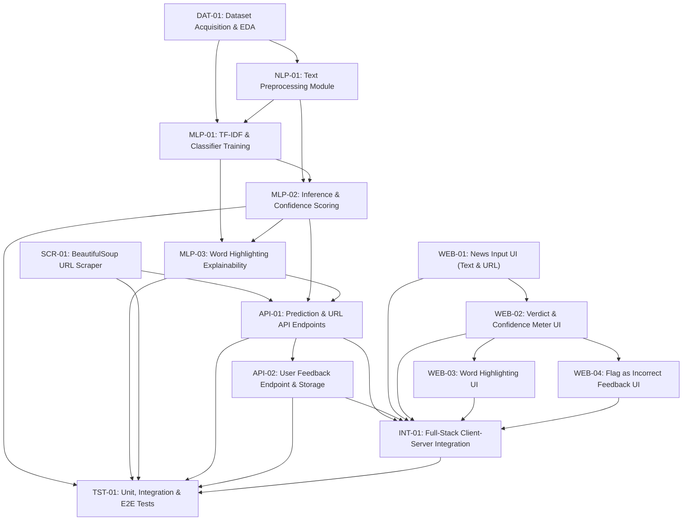

# Fake News Detection System — Feature Specifications & Dependency Map

This document catalogs all features to be developed for the **Fake News Detection System**, derived from [`fake_news_detection_project_spec.md`](../fake_news_detection_project_spec.md) and aligned with the initialized FastAPI (`backend/`) and React + TypeScript (`frontend/`) workspaces.

---

## 1. Baseline Already Initialized (Prerequisites Complete)

The following foundational setup from **Milestone 1** is already in place on `main`:
- **Repository & Python Environment**: Project directory structure (`backend/`, `frontend/`, `data/`, `models/`, `notebooks/`, `tests/`, `docs/`), `.gitignore`, and `requirements.txt`.
- **Backend Skeleton**: FastAPI app (`backend/app.py`) with CORS middleware, `GET /` and `GET /health` endpoints, health tests (`tests/test_health.py`), and module stubs (`backend/scraper.py`, `backend/predictor.py`).
- **Frontend Skeleton**: Vite + React 19 + TypeScript + Tailwind CSS v4 workspace (`frontend/`) with core API TypeScript interfaces (`frontend/src/types/index.ts`).

---

## 2. Feature Code Convention (`AAA-number`)

Each feature uses a `AAA-number` identifier where `AAA` denotes the architectural domain:

| Prefix | Domain | Primary Owner |
| :--- | :--- | :--- |
| **`DAT`** | Data Acquisition, Cleaning & Exploration | Person A (ML & Data) |
| **`NLP`** | Natural Language Processing & Text Normalization | Person A (ML & Data) |
| **`MLP`** | Machine Learning Pipeline, Inference & Explainability | Person A (ML & Data) |
| **`SCR`** | Web Scraping & Article Extraction | Person B (Full-Stack & Integration) |
| **`API`** | FastAPI Schemas, Endpoints & Persistence | Person B (Full-Stack & Integration) |
| **`WEB`** | React Frontend Components & Visualization | Person B (Full-Stack & Integration) |
| **`INT`** | Full-Stack Client-Server Wiring & State Management | Person B (Full-Stack & Integration) |
| **`TST`** | Automated Unit, Integration & End-to-End Testing | Both (Person A & Person B) |

---

## 3. Feature Summary & Dependency Matrix

| Code | Feature Title | Owner | Milestone | Status | Depends On |
| :--- | :--- | :--- | :--- | :--- | :--- |
| **[DAT-01](#dat-01--dataset-acquisition-validation--exploratory-analysis)** | Dataset Acquisition, Validation & Exploratory Analysis | Carina | Milestone 1 | Planned | *None* |
| **[NLP-01](#nlp-01--text-preprocessing--linguistic-normalization-module)** | Text Preprocessing & Linguistic Normalization Module | Person A | Milestone 2 | Planned | `DAT-01` |
| **[MLP-01](#mlp-01--tf-idf-vectorization--classifier-training-pipeline)** | TF-IDF Vectorization & Classifier Training Pipeline | Person A | Milestone 2 | Planned | `DAT-01`, `NLP-01` |
| **[MLP-02](#mlp-02--model-loader-credibility-inference--confidence-scoring)** | Model Loader, Credibility Inference & Confidence Scoring | Person A | Milestone 3 & 4 | Planned | `NLP-01`, `MLP-01` |
| **[MLP-03](#mlp-03--feature-weight-explainability--word-highlighting-engine)** | Feature Weight Explainability & Word Highlighting Engine | Person A | Milestone 4 | Planned | `MLP-01`, `MLP-02` |
| **[SCR-01](#scr-01--news-article-url-scraper)** | News Article URL Scraper (`BeautifulSoup`) | Person B | Milestone 3 | Planned | *None* |
| **[API-01](#api-01--credibility-prediction--url-analysis-api-endpoints)** | Credibility Prediction & URL Analysis API Endpoints | Person B | Milestone 3 & 4 | Planned | `SCR-01`, `MLP-02`, `MLP-03` |
| **[API-02](#api-02--user-feedback-loop-api--persistence)** | User Feedback Loop API & Persistence | Person B | Milestone 4 | Planned | `API-01` |
| **[WEB-01](#web-01--news-submission-interface-text--url-modes)** | News Submission Interface (Text & URL Modes) | Alin | Milestone 2 | **Done** | *None* |
| **[WEB-02](#web-02--credibility-verdict--confidence-score-visualization)** | Credibility Verdict & Confidence Score Visualization | Person B | Milestone 4 | Planned | `WEB-01` |
| **[WEB-03](#web-03--explainable-word-highlighting-view)** | Explainable Word Highlighting View | Person B | Milestone 4 | Planned | `WEB-02` |
| **[WEB-04](#web-04--user-feedback-flag-as-incorrect-ui-flow)** | User Feedback ("Flag as Incorrect") UI Flow | Person B | Milestone 4 | Planned | `WEB-02` |
| **[INT-01](#int-01--frontend-api-service--end-to-end-state-integration)** | Frontend API Service & End-to-End State Integration | Person B | Milestone 4 | Planned | `API-01`, `API-02`, `WEB-01`, `WEB-02`, `WEB-03`, `WEB-04` |
| **[TST-01](#tst-01--automated-unit-integration--e2e-pipeline-test-suite)** | Automated Unit, Integration & E2E Pipeline Test Suite | Both | Milestone 4 | Planned | `MLP-02`, `MLP-03`, `SCR-01`, `API-01`, `API-02`, `INT-01` |

---

## 4. Dependency Graph

---

## 5. Detailed Feature Specifications

---

### `DAT-01` — Dataset Acquisition, Validation & Exploratory Analysis
- **Owner**: Person A (Machine Learning & Data)
- **Milestone**: Milestone 1 (Project Setup & Data)
- **Target Paths**: `data/`, `notebooks/01_data_exploration.ipynb`
- **Depends On**: *None*
- **Required By**: `NLP-01`, `MLP-01`

#### Specifications
1. **Dataset Ingestion**:
   - Download and place raw fake/real news datasets (e.g., Kaggle ISOT Fake News Dataset: `True.csv` and `Fake.csv`, or WELFake) inside `data/` (excluded from Git via `.gitignore`, documented with download instructions).
   - Assign binary ground-truth labels: `REAL` (`1` or `'REAL'`) and `FAKE` (`0` or `'FAKE'`).
2. **Data Integrity & Hygiene**:
   - Merge `title` and `text` fields into a unified input corpus (`full_text = title + " " + text`) while also inspecting standalone body performance.
   - Detect and drop exact duplicate articles, null/NaN text entries, and whitespace-only rows.
   - Check class balance (`REAL` vs. `FAKE` counts) and document distributions (article word length, subject categories, publication dates).
3. **Data Leakage Audit**:
   - Identify publisher/wire-service boilerplate prefixes (e.g., `"WASHINGTON (Reuters) - "` in ISOT `True.csv`) so `NLP-01` strips source identifiers rather than letting the model memorize publisher names.
4. **Cleaned Export**:
   - Export a consolidated, deduplicated dataset (`data/processed_news.csv`) with columns: `id`, `title`, `text`, `label`.

#### Acceptance Criteria
- [ ] Reproducible notebook `notebooks/01_data_exploration.ipynb` loads raw CSVs, outputs class balance charts/stats, and saves `data/processed_news.csv`.
- [ ] Zero null, empty, or duplicate `text` rows remain in the processed dataset.
- [ ] Source-leakage patterns are documented for removal in `NLP-01`.

---

### `NLP-01` — Text Preprocessing & Linguistic Normalization Module
- **Owner**: Person A (Machine Learning & Data)
- **Milestone**: Milestone 2 (The Core Model)
- **Target Paths**: `backend/preprocessing.py` (or shared function imported by both `notebooks/` and `backend/predictor.py`)
- **Depends On**: `DAT-01`
- **Required By**: `MLP-01`, `MLP-02`

#### Specifications
1. **Shared Train-Serve Consistency**:
   - Implement text cleaning as an importable Python function (`preprocess_text(text: str) -> str`) so the exact same transformation runs during notebook training (`MLP-01`) and live API inference (`MLP-02`), preventing train-serve skew.
2. **Noise & Boilerplate Removal**:
   - Strip dateline/agency headers (e.g., `^.*?\(Reuters\)\s*-\s*`) identified in `DAT-01`.
   - Remove HTML tags, embedded URLs (`http://...`, `https://...`, `www....`), email addresses, and excessive punctuation/control characters.
   - Normalize case to lowercase and collapse repeated whitespace.
3. **Linguistic Filtering (`NLTK` / `spaCy`)**:
   - Remove English stop words (e.g., `"the"`, `"and"`, `"is"`) while preserving negation cues if impactful (e.g., `"not"`, `"never"`, `"fake"`, `"hoax"`).
   - Reduce tokens to root/lemma forms (lemmatization via `spaCy` `en_core_web_sm` or `NLTK` `WordNetLemmatizer`) to consolidate inflected word variants.
4. **Edge-Case Handling**:
   - Gracefully handle empty strings, non-ASCII characters/emojis, and very long articles without crashing.

#### Acceptance Criteria
- [ ] `preprocess_text()` deterministically cleans raw strings into normalized token sequences.
- [ ] URLs, HTML remnants, stop words, and agency datelines are stripped accurately.
- [ ] Function executes in `< 50ms` for a typical 1,000-word article during single-document API inference.

---

### `MLP-01` — TF-IDF Vectorization & Classifier Training Pipeline
- **Owner**: Person A (Machine Learning & Data)
- **Milestone**: Milestone 2 (The Core Model)
- **Target Paths**: `notebooks/02_model_training.ipynb`, `models/model.pkl`
- **Depends On**: `DAT-01`, `NLP-01`
- **Required By**: `MLP-02`, `MLP-03`

#### Specifications
1. **Dataset Splitting**:
   - Perform stratified train/validation/test split (e.g., `80% / 10% / 10%` with fixed `random_state=42`) on `data/processed_news.csv`.
2. **Feature Extraction (`TfidfVectorizer`)**:
   - Configure Scikit-Learn `TfidfVectorizer` with:
     - Unigrams and bigrams (`ngram_range=(1, 2)`) to capture sensationalist phrases.
     - Vocabulary cap (e.g., `max_features=50000`), `min_df=2`, `max_df=0.95`, and `sublinear_tf=True`.
3. **Classifier Selection & Probability Calibration**:
   - Train and compare lightweight linear classifiers specified in the project spec:
     - `LogisticRegression` (natively supports calibrated `predict_proba` and linear `coef_`).
     - `PassiveAggressiveClassifier` wrapped in `CalibratedClassifierCV` (since raw `PassiveAggressiveClassifier` only exposes `decision_function` and requires calibration to output accurate probability percentages for `MLP-02`).
4. **Evaluation Metrics**:
   - Compute and log Accuracy, Precision, Recall, F1-Score, ROC-AUC, and a Confusion Matrix on the held-out test set.
5. **Artifact Serialization**:
   - Bundle vectorizer + trained classifier into a single Scikit-Learn `Pipeline` (or structured dictionary artifact containing `vectorizer`, `classifier`, `classes`, and `metadata`) and serialize via `joblib.dump` / `pickle` to `models/model.pkl`.

#### Acceptance Criteria
- [ ] Training notebook executes end-to-end and achieves strong held-out generalization (target F1 `>= 0.90` on benchmark dataset without publisher leakage).
- [ ] `models/model.pkl` is exported and exposes both probability estimation (`predict_proba`) and linear feature weights (`coef_`).

---

### `MLP-02` — Model Loader, Credibility Inference & Confidence Scoring
- **Owner**: Person A (Machine Learning & Data)
- **Milestone**: Milestone 3 & Milestone 4
- **Target Paths**: `backend/predictor.py`
- **Depends On**: `NLP-01`, `MLP-01`
- **Required By**: `MLP-03`, `API-01`, `TST-01`

#### Specifications
1. **Singleton / Cached Model Loading**:
   - Load `models/model.pkl` once on application startup or first request (using `functools.lru_cache` or module-level singleton) so requests do not incur disk I/O overhead.
   - Define custom exception `ModelNotLoadedError` if `models/model.pkl` is missing or corrupted, allowing FastAPI to return a clean `503 Service Unavailable` diagnostic (or optional configurable mock mode during local UI development).
2. **Credibility Verdict Prediction**:
   - Implement `predict_credibility(text: str) -> dict`:
     - Validate raw text is non-empty and meets minimum meaningful token count after `NLP-01` preprocessing (e.g., `>= 5` tokens; raise `ValueError` otherwise).
     - Predict normalized verdict string: `'REAL'` or `'FAKE'` (matching `frontend/src/types/index.ts`).
3. **Confidence Scoring (Standout CV Feature)**:
   - Extract predicted class probability via `predict_proba()` for the winning class.
   - Return `confidence` standardized across the API contract as a float in `[0.0, 1.0]` rounded to 4 decimal places (e.g., `0.9420`, formatted as `94.2%` by the frontend in `WEB-02`).

#### Acceptance Criteria
- [ ] `predict_credibility()` loads `models/model.pkl` in memory once and runs single-article inference in `< 100ms`.
- [ ] Returns deterministic `'REAL' | 'FAKE'` verdict alongside calibrated `confidence` score.
- [ ] Raises descriptive errors when input text has insufficient tokens or model file is absent.

---

### `MLP-03` — Feature Weight Explainability & Word Highlighting Engine
- **Owner**: Person A (Machine Learning & Data)
- **Milestone**: Milestone 4 (Standout CV Feature: Word Highlighting / Explainability)
- **Target Paths**: `backend/predictor.py`
- **Depends On**: `MLP-01`, `MLP-02`
- **Required By**: `API-01`, `TST-01`

#### Specifications
1. **Per-Document Feature Attribution**:
   - Given an input article's TF-IDF vector `x` and the linear classifier's weight vector `w` (`coef_`), compute per-feature contribution scores `c_i = x_i * w_i`.
   - Note: If using `CalibratedClassifierCV`, average `coef_` across base estimators (`calibrated_classifiers_`).
2. **Sensationalist / Influential Token Selection**:
   - Filter features present in the document (`x_i > 0`) that push the prediction toward the predicted verdict (especially sensationalist words/phrases driving a `'FAKE'` classification, or strong credibility indicators for `'REAL'`).
   - Rank by magnitude `|c_i|` and extract the top `K` tokens/phrases (default `K = 10` to `15`).
3. **Normalized Output Contract**:
   - Normalize or round weights into `[0.0, 1.0]` relative importance (or signed weight) matching `HighlightToken` (`{ "word": str, "weight": float }`).
   - Map lemmatized tokens back to matching surface words appearing in the original raw text where applicable so `WEB-03` can highlight exact substrings in the article body.

#### Acceptance Criteria
- [ ] `predict_credibility()` includes `highlights: list[dict[str, float | str]]` sorted by descending importance.
- [ ] Returned `word` entries actually appear in (or directly correspond to) the submitted article text.
- [ ] Weights are finite floats (`no NaN / Inf`) normalized for straightforward frontend visualization.

---

### `SCR-01` — News Article URL Scraper
- **Owner**: Person B (Full-Stack & Integration)
- **Milestone**: Milestone 3 (URL Scraping & API Logic — Standout CV Feature: URL Parsing)
- **Target Paths**: `backend/scraper.py`
- **Depends On**: *None*
- **Required By**: `API-01`, `TST-01`

#### Specifications
1. **URL Validation & SSRF Protection**:
   - Validate URL scheme is strictly `http` or `https`.
   - Resolve hostname and block loopback, link-local, and private network IPs (`127.0.0.0/8`, `10.0.0.0/8`, `172.16.0.0/12`, `192.168.0.0/16`, `::1`, `169.254.169.254`) to prevent Server-Side Request Forgery (SSRF).
2. **HTTP Fetching (`requests`)**:
   - Send `GET` request with realistic browser `User-Agent` and `Accept-Language` headers to minimize `403 Forbidden` rejections from news publishers.
   - Enforce strict connection/read timeouts (e.g., `timeout=(5, 10)` seconds) and maximum response payload cap (e.g., `5 MB`), verifying `Content-Type` starts with `text/html` or `application/xhtml+xml`.
3. **HTML Parsing & Main Content Extraction (`BeautifulSoup` + `lxml`)**:
   - Extract article headline via `<meta property="og:title">`, `<meta name="twitter:title">`, `<h1>`, or `<title>`.
   - Remove non-article DOM clutter prior to text extraction: `<script>`, `<style>`, `<noscript>`, `<nav>`, `<header>`, `<footer>`, `<aside>`, `<form>`, `<iframe>`, and common ad/cookie banners.
   - Extract paragraph `
` text prioritizing semantic containers (`<article>`, `<main>`, `[role="main"]`), falling back to document-wide `
` aggregation if semantic containers are absent.
   - Join paragraphs with clean newline spacing and strip boilerplate short fragments (e.g., `
` tags with fewer than 5 words that are typically menu/caption artifacts).
4. **Post-Extraction Validation & Exceptions**:
   - Require minimum extracted body length (e.g., `>= 100` characters / `>= 20` words); otherwise raise `EmptyArticleError` (e.g., JS-only SPA or hard paywall).
   - Define clean exception hierarchy (`InvalidURLError`, `ScrapeFetchError`, `EmptyArticleError`) for `API-01` error mapping.
   - Return `{ "url": str, "title": str, "text": str }`.

#### Acceptance Criteria
- [ ] `extract_article_text(url)` reliably extracts clean headline and multi-paragraph body text from standard news articles.
- [ ] Rejects invalid schemes (`file://`, `ftp://`, `javascript:`) and private/localhost IPs.
- [ ] Times out cleanly within 10 seconds and raises structured exceptions on HTTP 4xx/5xx or paywalled/empty pages.

---

### `API-01` — Credibility Prediction & URL Analysis API Endpoints
- **Owner**: Person B (Full-Stack & Integration)
- **Milestone**: Milestone 3 & Milestone 4
- **Target Paths**: `backend/schemas.py`, `backend/app.py`
- **Depends On**: `SCR-01`, `MLP-02`, `MLP-03`
- **Required By**: `API-02`, `INT-01`, `TST-01`

#### Specifications
1. **Pydantic v2 Request & Response Schemas (`backend/schemas.py`)**:
   - Align field names and types directly with `frontend/src/types/index.ts`:
     - **`PredictionRequest`**:
       - `text: str | None = None` (if provided without `url`, min length `30` chars, max length `100_000` chars).
       - `url: HttpUrl | str | None = None`.
       - Model-level validator (`@model_validator`) enforcing that at least one of `text` or `url` is non-empty (if both provided, `url` takes precedence or raises a clear validation error — document precedence: if `url` is provided, scrape `url`; else analyze `text`).
     - **`HighlightToken`**:
       - `word: str`
       - `weight: float`
     - **`PredictionResponse`**:
       - `verdict: Literal["REAL", "FAKE"]`
       - `confidence: float` (standardized in `[0.0, 1.0]`, e.g., `0.925` representing `92.5%`)
       - `title: str | None = None` (populated when scraped from URL)
       - `text: str` (analyzed article text — essential when input was a URL so `WEB-03` can render inline word highlights!)
       - `highlights: list[HighlightToken] = []`
2. **Endpoint `POST /api/predict` (`backend/app.py`)**:
   - If `request.url` is supplied: invoke `SCR-01` (`extract_article_text`) to obtain `title` and `text`.
   - Pass `text` (or `title + "\n\n" + text`) to `MLP-02` / `MLP-03` (`predict_credibility`) to obtain `verdict`, `confidence`, and `highlights`.
   - Return validated `PredictionResponse`.
3. **HTTP Error Mapping**:
   - `422 Unprocessable Entity`: Missing both `text` and `url`, malformed URL, or text shorter than minimum length.
   - `400 Bad Request`: Disallowed URL / SSRF blocked (`InvalidURLError`) or insufficient extractable article text (`EmptyArticleError`).
   - `502 Bad Gateway`: Upstream news site unreachable, timed out, or blocked scraping (`ScrapeFetchError`).
   - `503 Service Unavailable`: ML model `.pkl` missing/not loaded (`ModelNotLoadedError`).
4. **Enhanced `GET /health`**:
   - Include `model_loaded: bool` status alongside `status: "healthy"` so the frontend knows if inference is ready.

#### Acceptance Criteria
- [ ] `POST /api/predict` accepts `{ "text": "..." }` and returns `{ verdict, confidence, text, highlights }`.
- [ ] `POST /api/predict` accepts `{ "url": "https://..." }`, scrapes article title & body, and returns `{ verdict, confidence, title, text, highlights }`.
- [ ] OpenAPI docs (`/docs`) display complete request/response schemas and status codes.

---

### `API-02` — User Feedback Loop API & Persistence
- **Owner**: Person B (Full-Stack & Integration)
- **Milestone**: Milestone 4 (Standout CV Feature: User Feedback Loop)
- **Target Paths**: `backend/schemas.py`, `backend/feedback.py`, `backend/app.py`
- **Depends On**: `API-01`
- **Required By**: `INT-01`, `TST-01`

#### Specifications
1. **Feedback Schema (`backend/schemas.py`)**:
   - Compatible with `frontend/src/types/index.ts` (`FeedbackRequest`) with optional context fields for future model retraining:
     - `predictedVerdict: Literal["REAL", "FAKE"]`
     - `userFeedback: Literal["AGREE", "DISAGREE"]`
     - `comment: str | None = Field(default=None, max_length=1000)`
     - `url: str | None = None` (optional context of the analyzed article)
     - `text: str | None = Field(default=None, max_length=100_000)` (optional snippet/body for retraining dataset)
     - `confidence: float | None = None`
   - **`FeedbackResponse`**:
     - `id: str` (UUID4)
     - `status: Literal["recorded"]`
     - `timestamp: str` (ISO-8601 UTC)
2. **Persistence Layer (`backend/feedback.py`)**:
   - Append validated feedback entries as single-line JSON records to `data/feedback.jsonl` (auto-creating `data/` if needed, excluded from Git via `.gitignore`).
   - Use thread-safe lock (`threading.Lock`) around file writes to prevent interleaved lines under concurrent requests.
3. **Endpoint `POST /api/feedback` (`backend/app.py`)**:
   - Validate request body, persist record via `backend/feedback.py`, and return `201 Created` with `FeedbackResponse`.

#### Acceptance Criteria
- [ ] `POST /api/feedback` stores structured JSONL entries with UUID and UTC timestamp in `data/feedback.jsonl`.
- [ ] Rejects invalid `predictedVerdict` or `userFeedback` values with `422`.
- [ ] Concurrent feedback submissions write cleanly without corrupting JSONL lines.

---

### `WEB-01` — News Submission Interface (Text & URL Modes)
- **Status**: Done
- **Owner**: Alin (Full-Stack & Integration)
- **Milestone**: Milestone 2 (Frontend Search/Input UI)
- **Target Paths**: `frontend/src/components/NewsInputForm.tsx`
- **Depends On**: *None*
- **Required By**: `WEB-02`, `INT-01`

#### Specifications
1. **Dual-Mode Input Selector**:
   - Segmented tab toggle allowing users to switch cleanly between:
     - **"Paste URL" Mode**: Single-line URL input (`type="url"`) with link icon and placeholder (`https://example.com/news-article`).
     - **"Paste Article Text" Mode**: Multi-line auto-resizing `<textarea>` with placeholder for pasting headline and article paragraphs.
2. **Client-Side Validation & UX Helpers**:
   - Validate URL starts with `http://` or `https://` and is syntactically valid before enabling submit.
   - Validate pasted text meets minimum character threshold (`>= 30` trimmed characters) and display live word & character count.
   - Provide **"Try Sample"** quick-fill buttons (1 sample real-style dispatch, 1 sample sensationalist/fake-style article) for instant demonstration and testing.
   - Provide a **"Clear"** button to reset input and current results.
3. **Submission Controls**:
   - Primary **"Check News"** submit button (`lucide-react` icon + loading spinner when `isLoading` is `true`).
   - Disable inputs and submit button while an analysis request is in flight.

#### Acceptance Criteria
- [x] Users can toggle seamlessly between URL mode and Raw Text mode without losing typed state unintentionally.
- [x] Invalid URLs and overly short text display clear inline validation hints and prevent invalid submissions.
- [x] Responsive layout works cleanly across mobile (`375px`) and desktop (`1280px+`) viewports.

---

### `WEB-02` — Credibility Verdict & Confidence Score Visualization
- **Owner**: Person B (Full-Stack & Integration)
- **Milestone**: Milestone 4 (Standout CV Feature: Confidence Scoring UI)
- **Target Paths**: `frontend/src/components/PredictionResultCard.tsx`
- **Depends On**: `WEB-01`
- **Required By**: `WEB-03`, `WEB-04`, `INT-01`

#### Specifications
1. **Verdict Banner**:
   - Prominent badge and icon indicating **`REAL` (Likely Credible)** in emerald/green styling vs. **`FAKE` (Likely Fabricated / Unreliable)** in rose/red styling.
   - Include an AI disclaimer subtitle clarifying that the score reflects linguistic pattern analysis rather than factual verification of live events.
2. **Confidence Score Meter**:
   - Format `confidence` (`0.0–1.0`) as a clear percentage (e.g., `93.4%`).
   - Render a visual progress bar / gauge with smooth width transition and semantic certainty label:
     - `< 65%`: *Low Confidence (Borderline)*
     - `65% – 84%`: *Moderate Confidence*
     - `>= 85%`: *High Confidence*
3. **Scraped Metadata Header**:
   - When analyzed via URL, display the extracted article `title` and a clickable external link to the source `url` (`rel="noopener noreferrer" target="_blank"`).

#### Acceptance Criteria
- [ ] Clearly distinguishes `REAL` and `FAKE` verdicts using accessible color contrast, icons, and text labels (not color alone).
- [ ] Accurately formats `confidence` percentage and renders visual progress bar without overflow for boundary values (`0.50`, `1.00`).

---

### `WEB-03` — Explainable Word Highlighting View
- **Owner**: Person B (Full-Stack & Integration)
- **Milestone**: Milestone 4 (Standout CV Feature: Word Highlighting / Explainability UI)
- **Target Paths**: `frontend/src/components/HighlightedArticleView.tsx`
- **Depends On**: `WEB-02`
- **Required By**: `INT-01`

#### Specifications
1. **Top Contributing Words Summary**:
   - Display a horizontal list of pill/chip badges for top `highlights` (`HighlightToken[]`), showing each `word` and its relative weight bar or percentage.
2. **Inline Text Highlighting**:
   - Tokenize/segment the returned `text` safely in React (rendering `<mark>` elements — **never** `dangerouslySetInnerHTML`, preventing XSS from scraped third-party web pages).
   - Case-insensitively match whole words/phrases from `highlights` and apply background highlight intensity scaled by `weight` (e.g., amber/rose tint tiers for fake-leaning sensationalist terms, emerald/blue tint tiers for real-leaning terms).
   - Show hover/focus tooltip on highlighted words displaying their relative contribution weight.
3. **Collapsible Long-Text Reader**:
   - For long scraped articles (`> 300` words), provide an "Expand Full Article / Show Less" toggle so the page remains compact while allowing full inspection.

#### Acceptance Criteria
- [ ] Scraped or pasted text renders with highlighted influential words matching `highlights` without raw HTML injection vulnerabilities.
- [ ] Gracefully handles empty `highlights: []` by rendering clean unhighlighted article text with an informational note.

---

### `WEB-04` — User Feedback ("Flag as Incorrect") UI Flow
- **Owner**: Person B (Full-Stack & Integration)
- **Milestone**: Milestone 4 (Standout CV Feature: User Feedback Loop UI)
- **Target Paths**: `frontend/src/components/FeedbackWidget.tsx`
- **Depends On**: `WEB-02`
- **Required By**: `INT-01`

#### Specifications
1. **Feedback Actions**:
   - Render a compact footer section inside the results area asking *"Does this assessment look accurate?"* with two buttons:
     - **"Looks Accurate"** (`userFeedback = 'AGREE'`)
     - **"Flag as Incorrect"** (`userFeedback = 'DISAGREE'`)
2. **Comment Expansion on Flagging**:
   - Clicking **"Looks Accurate"** immediately submits `{ predictedVerdict, userFeedback: 'AGREE' }`.
   - Clicking **"Flag as Incorrect"** expands an optional comment input (*"Why do you think this prediction is wrong? (Optional)"*) with **"Submit Flag"** and **"Cancel"** buttons.
3. **Submission Lifecycle**:
   - Show loading state while `POST /api/feedback` is in flight.
   - Upon success, transition widget into a locked confirmation badge (*"Thank you! Your feedback has been logged for model improvement."*) so the same prediction cannot be spammed repeatedly.
   - Reset widget state automatically whenever a new article prediction is run.

#### Acceptance Criteria
- [ ] Both `AGREE` and `DISAGREE` ("Flag as Incorrect") flows emit valid payloads matching `FeedbackRequest`.
- [ ] Confirmation state prevents duplicate clicks for the same result and resets cleanly on a new check.

---

### `INT-01` — Frontend API Service & End-to-End State Integration
- **Owner**: Person B (Full-Stack & Integration)
- **Milestone**: Milestone 4 (Assembly & Polish)
- **Target Paths**: `frontend/src/services/api.ts`, `frontend/src/types/index.ts`, `frontend/src/App.tsx`, `frontend/.env.example`
- **Depends On**: `API-01`, `API-02`, `WEB-01`, `WEB-02`, `WEB-03`, `WEB-04`
- **Required By**: `TST-01`

#### Specifications
1. **Typed API Client (`frontend/src/services/api.ts`)**:
   - Configure base URL via `import.meta.env.VITE_API_BASE_URL || 'http://127.0.0.1:8000'`.
   - Implement typed async methods:
     - `checkHealth(): Promise<{ status: string; model_loaded?: boolean }>`
     - `analyzeNews(payload: PredictionRequest, signal?: AbortSignal): Promise<PredictionResponse>`
     - `submitFeedback(payload: FeedbackRequest): Promise<void>`
   - Parse FastAPI `{ detail: ... }` error responses into human-readable `ApiError` instances.
2. **Type Alignment (`frontend/src/types/index.ts`)**:
   - Extend `FeedbackRequest` with optional `url?: string`, `text?: string`, and `confidence?: number` fields to match `API-02` while preserving full backward compatibility.
3. **Application Orchestration (`frontend/src/App.tsx`)**:
   - Replace the static initialization placeholder in `App.tsx` with the complete interactive workflow:
     - Header with live backend health badge (`API Online` / `Model Ready` vs `Backend Offline`).
     - `NewsInputForm` (`WEB-01`) wired to `analyzeNews()`.
     - Dismissible error alert banner when scraping or prediction fails (e.g., paywalled URL, invalid link, backend unreachable).
     - Results container rendering `PredictionResultCard` (`WEB-02`), `HighlightedArticleView` (`WEB-03`), and `FeedbackWidget` (`WEB-04`).

#### Acceptance Criteria
- [ ] Pasting a news URL or article text in the browser sends a live request to FastAPI and renders verdict, confidence percentage, highlighted words, and feedback controls.
- [ ] Network failures, timeouts, and backend `400`/`422`/`502`/`503` errors display clear, non-crashing UI error banners.
- [ ] `npm run build` (`tsc -b && vite build`) and `npm run lint` (`oxlint`) pass with zero errors.

---

### `TST-01` — Automated Unit, Integration & E2E Pipeline Test Suite
- **Owner**: Both (Person A & Person B)
- **Milestone**: Milestone 4 (Full Pipeline Verification)
- **Target Paths**: `tests/test_preprocessing.py`, `tests/test_predictor.py`, `tests/test_scraper.py`, `tests/test_api.py`
- **Depends On**: `MLP-02`, `MLP-03`, `SCR-01`, `API-01`, `API-02`, `INT-01`
- **Required By**: *None (Final Milestone Verification)*

#### Specifications
1. **NLP & ML Unit Tests (`tests/test_preprocessing.py`, `tests/test_predictor.py`)**:
   - Verify stopword/URL/dateline removal in `NLP-01`.
   - Verify `predict_credibility()` output schema, confidence bounds (`0.0 <= confidence <= 1.0`), non-empty `highlights` structure, and error handling on empty/short strings.
2. **Scraper Unit Tests (`tests/test_scraper.py`)**:
   - Mock `requests.get` to test HTML extraction of `<article>` / `
` tags, `<script>`/`<nav>` stripping, timeout handling, HTTP `403`/`404` handling, paywall/short-text rejection, and SSRF rejection of `http://127.0.0.1` / `http://169.254.169.254`.
3. **FastAPI Integration Tests (`tests/test_api.py`)**:
   - Use FastAPI `TestClient` to test `POST /api/predict` (both raw `text` mode and mocked `url` scrape mode), validation errors (`422`), and `POST /api/feedback` persistence using pytest `tmp_path` isolation (so tests never pollute `data/feedback.jsonl`).
4. **End-to-End Pipeline Checklist**:
   - Document and verify full user flow: *Submit Live URL -> Scraper extracts article -> Model predicts verdict, confidence & word highlights -> React UI renders results -> User submits Flag as Incorrect feedback*.

#### Acceptance Criteria
- [ ] `pytest` passes 100% of unit and API integration tests cleanly without requiring live external internet access during CI runs.
- [ ] Frontend build (`npm run build`) and linter (`npm run lint`) pass cleanly.
- [ ] End-to-end manual/automated smoke check confirms full URL-to-UI-to-feedback pipeline works seamlessly.
